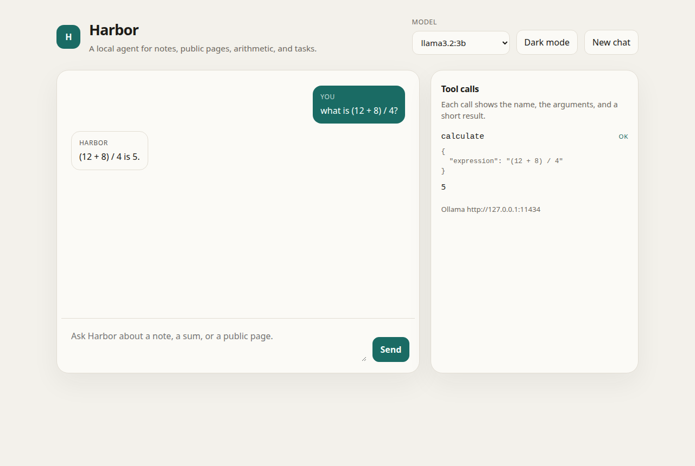
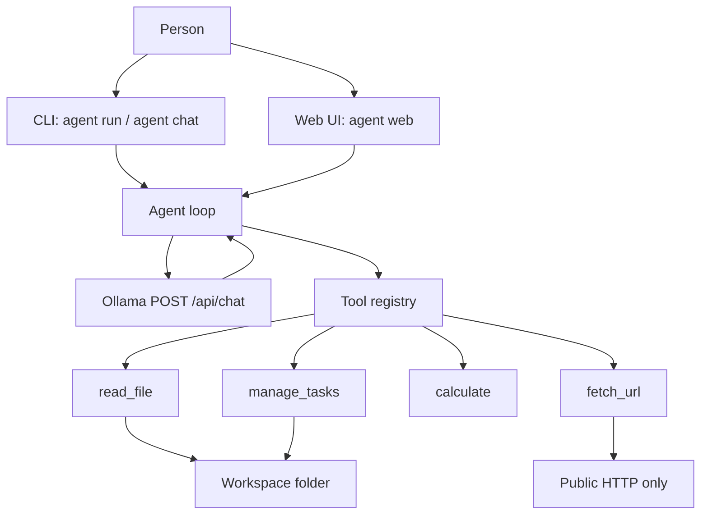

<div align="center">

# Harbor

A local Ollama agent with sandboxed tools, a CLI, and a one-page UI.

[](https://github.com/souzawellington/harbor-local-agent/actions/workflows/ci.yml)
[](https://www.python.org/)
[](LICENSE)



</div>

Harbor talks to a local [Ollama](https://ollama.com) model, calls a few tools, and shows every call. It is a single-user program on one machine. The source on GitHub is [souzawellington/harbor-local-agent](https://github.com/souzawellington/harbor-local-agent).

Tests mock Ollama's HTTP API. They do not prove that a particular model will choose the right tool. The screenshot above was taken against that same mocked backend, not a live model.

## Features

- `agent run` for one task, `agent chat` for a conversation, and `agent web` for the local UI.
- The UI shows the reply, a loading state, the configured model, and each tool call with its arguments and a short result.
- Light and dark mode. The page stacks on a narrow window.
- If Ollama is not running, the UI says so and disables sending until you check again.
- File tools stay inside the workspace. There is no shell tool. `fetch_url` allows public `http` and `https` only.

## Architecture



Each user message is a loop. Harbor sends the conversation and the tool schemas to Ollama with `stream` set to false and temperature 0. Tool results go back as `role: tool` messages. The loop stops on a normal answer, or after `AGENT_MAX_STEPS` (default 6, maximum 20). The web UI uses this loop. It does not stream tokens. It shows "Working…" until the turn finishes.

## Quickstart

Install [Ollama](https://ollama.com/download), then pull a small tool-capable model:

```bash
ollama pull llama3.2:3b
```

`qwen2.5:3b` is a reasonable alternative. Pull it and set `OLLAMA_MODEL=qwen2.5:3b`.

From this repository, with Python 3.11 or newer:

```bash
python3 -m venv .venv
source .venv/bin/activate
python -m pip install -e .
cp .env.example .env
agent run "Summarise notes/welcome.md"
agent chat
agent web
```

`agent web` listens on [http://127.0.0.1:8765](http://127.0.0.1:8765). Use `--port` to change it. The default bind is localhost. Harbor has no login, so do not expose it on a network.

On Windows, activate with `.venv\Scripts\activate`. You can also run `python -m harbor`.

CLI flags: `--model`, `--workspace`, `--host`, and `--max-steps`. `agent tools` lists the tools without calling the model.

Exit codes for `agent run`: `0` when the model finished, `1` when Ollama could not be reached or a setting is invalid, `2` when the step limit stopped the loop.

```bash
python -m pip install -e ".[dev]"
ruff check .
ruff format --check .
pytest
```

## Tools

| Tool | What it does |
| --- | --- |
| `read_file` | Read a `.md`, `.markdown`, or `.txt` file inside the workspace. `outline` returns headings and a word count. `full` returns the text. |
| `fetch_url` | Fetch a public `http` or `https` page and return visible text. Private and loopback addresses are refused. It does not run JavaScript. |
| `calculate` | Evaluate arithmetic (`+`, `-`, `*`, `/`, `//`, `%`, `**`, parentheses). No functions and no names. |
| `manage_tasks` | List, add, complete, or delete items in `tasks.json`. That file is the only one Harbor writes. |

## Project structure

```text
src/harbor/
  cli.py           agent chat, agent run, agent web, agent tools
  web.py           local FastAPI UI, same agent loop
  static/index.html
  agent.py         tool-calling loop
  client.py        POST /api/chat
  config.py        environment and .env
  sandbox.py       workspace path checks
  tools/           read_file, fetch_url, calculate, manage_tasks
tests/             pytest; Ollama is mocked
workspace/         sample note and task list
docs/web-ui.png    screenshot of the UI against the mocked backend
.github/workflows/ci.yml
```

The sample note is `workspace/notes/welcome.md`.

## Roadmap

- Stream tokens in the CLI and the UI. The UI currently waits for the whole turn.
- A workspace-only tool that appends to a Markdown note.
- A short recording at `docs/demo.gif`. It is not in the repository yet.
- A run against a live Ollama model. That has not been done here.

## License

Released under the MIT License. See [LICENSE](LICENSE).
