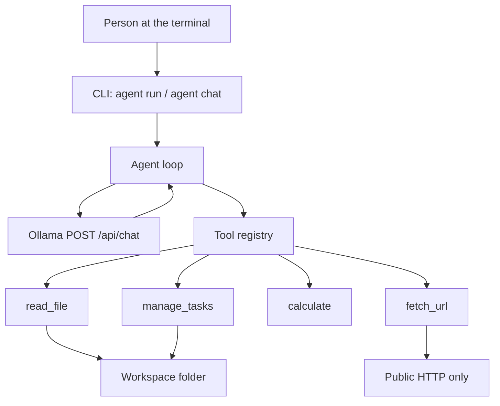

# Harbor

A small command-line agent that runs a local [Ollama](https://ollama.com) model, calls a few sandboxed tools, and prints every call it made.

Harbor is a portfolio project for a move into AI automation and API integrations: one tool-calling loop, one HTTP client, and tests that run without a GPU.

## Demo

```text
$ agent run "Summarise notes/welcome.md and add a task to review it"
tool  read_file  ok  {"path": "notes/welcome.md", "mode": "outline"}
      file: notes/welcome.md
      words: 85
      headings:
      # Workspace notes
      ## Focus
      ## This week
      ... (17 more lines)
tool  manage_tasks  ok  {"action": "add", "title": "Review notes/welcome.md"}
      Added task 2: Review notes/welcome.md

The note is a short brief. This folder is the only place Harbor can read,
and the focus is AI automation and API integrations. I added task 2,
"Review notes/welcome.md".
```

```text
$ agent chat
Harbor  model=llama3.2:3b  workspace=/path/to/workspace
Ask something, or type /exit.
you › what is (12 + 8) / 4?
tool  calculate  ok  {"expression": "(12 + 8) / 4"}
      5

(12 + 8) / 4 is 5.
you › /exit
bye
```

The `read_file` lines are the real outline of `workspace/notes/welcome.md`, printed by the CLI. The `manage_tasks` line is that same formatter around the message the tool returns when it adds a task. The prose after the blank line is an example of a model reply, not a captured generation. A short recording can be added later at `docs/demo.gif`. It is not in the repository yet.

If the model answers without calling a tool, Harbor prints `tools  (none)` so that is visible.

## Features

- `agent run "task"` for one shot, and `agent chat` for a conversation kept in that process.
- Four tools: read a workspace note, fetch a public page, evaluate arithmetic, manage a JSON task list.
- File access stays inside the workspace. Symlinks that resolve outside it are refused. There is no shell tool.
- `fetch_url` allows public `http` and `https` only. It does not use `HTTP_PROXY`, and it checks redirects again.
- Model, host, workspace, step limit, and timeout come from the environment or `.env`. The default model is `llama3.2:3b`.
- pytest mocks Ollama's HTTP API. GitHub Actions runs Ruff and pytest on Python 3.11.

## Architecture



Each user message is a loop. Harbor sends the conversation and the tool schemas to Ollama with `stream` set to false and temperature 0. If the reply contains `tool_calls`, Harbor runs those tools, appends a `role: tool` message with `tool_name`, and asks the model again. The loop stops when the model returns a normal answer, or when `AGENT_MAX_STEPS` is reached (default 6, maximum 20).

Harbor is a single-user program on one machine. It is not a hosted multi-tenant service. The boundary it does enforce is the workspace directory, plus the refusal to run a shell or to fetch a non-public address.

## Quickstart

Install [Ollama](https://ollama.com/download), then pull a small tool-capable model:

```bash
ollama pull llama3.2:3b
```

`qwen2.5:3b` is a reasonable alternative. Pull it and set `OLLAMA_MODEL=qwen2.5:3b`.

From this repository, with Python 3.11 or newer:

```bash
python3 -m venv .venv
source .venv/bin/activate
python -m pip install -e .
cp .env.example .env
agent run "Summarise notes/welcome.md"
agent chat
```

On Windows, activate the virtual environment with `.venv\Scripts\activate`. You can also run `python -m harbor` if the `agent` script is not on your `PATH`.

Useful flags: `--model`, `--workspace`, `--host`, and `--max-steps`. `agent tools` lists the tools without calling the model.

Exit codes: `0` when the model finished, `1` when Ollama could not be reached or a setting is invalid, `2` when the step limit stopped the loop.

To run the same checks as CI:

```bash
python -m pip install -e ".[dev]"
ruff check .
ruff format --check .
pytest
```

## Project layout

```text
src/harbor/
  cli.py        agent chat, agent run, agent tools
  agent.py      tool-calling loop
  client.py     POST /api/chat
  config.py     environment and .env
  sandbox.py    workspace path checks
  tools/        read_file, fetch_url, calculate, manage_tasks
tests/          pytest; Ollama is mocked
workspace/      sample note and task list
.github/workflows/ci.yml
```

The sample note is `workspace/notes/welcome.md`. Tasks live in `workspace/tasks.json`. That file is the only one Harbor writes.

## How to add a tool

Add a module under `src/harbor/tools/`, return a `Tool`, and register it in `build_registry` in `src/harbor/tools/__init__.py`. Read files through `read_text_file` so the workspace check stays in one place. Then add a pytest that covers the success path and one refusal.

```python
from pathlib import Path
from typing import Any

from harbor.sandbox import read_text_file
from harbor.tools.base import Tool
from harbor.tools.common import require_str


def make_word_count(root: Path) -> Tool:
    def handler(args: dict[str, Any]) -> str:
        relative = require_str(args, "path")
        path, text, _truncated = read_text_file(root, relative, max_chars=20_000)
        return f"{path.name}: {len(text.split())} words"

    return Tool(
        name="word_count",
        description="Count words in a workspace Markdown or text file.",
        parameters={
            "type": "object",
            "properties": {
                "path": {"type": "string", "description": "Workspace-relative path."}
            },
            "required": ["path"],
        },
        handler=handler,
    )
```

```python
def build_registry(workspace: Path) -> list[Tool]:
    root = workspace_root(workspace)
    return [
        make_read_file(root),
        make_fetch_url(),
        make_calculate(),
        make_manage_tasks(root),
        make_word_count(root),
    ]
```

Ollama receives the name, description, and JSON schema from `Tool.schema()`. Keep the description specific. Small models follow a short description more reliably than a vague one.

## Limitations

- A 3B model sometimes skips a tool or invents an argument. The trace is the record of what ran. Harbor does not hide a missed call.
- `fetch_url` is not a browser. It does not run JavaScript, and it will not log in.
- Text from files and pages is untrusted. The system prompt says to treat it as data. A small model can still be persuaded to call a tool. The sandbox limits that call to the workspace and to public URLs.
- The host is resolved and checked, then the HTTP client resolves it again. That leaves a DNS-rebinding gap.
- `read_file` only opens `.md`, `.markdown`, and `.txt`, and only up to 512 KB. Do not put secrets in the workspace.
- The calculator parses a syntax tree. It allows arithmetic only, refuses large exponents, and does not call functions.
- There is no authentication. Do not expose the process on a network.
- Harbor does not edit source files and does not run shell commands.
- Tests mock the documented `/api/chat` JSON. They do not prove that a particular model build will choose the right tool. See the note at the end of this file.

## Roadmap

- Stream tokens to the terminal.
- A workspace-only tool that appends to a Markdown note.
- A one-page local UI, if it stays smaller than the CLI.
- A GIF at `docs/demo.gif`.

## License

Released under the MIT License. See [LICENSE](LICENSE).
